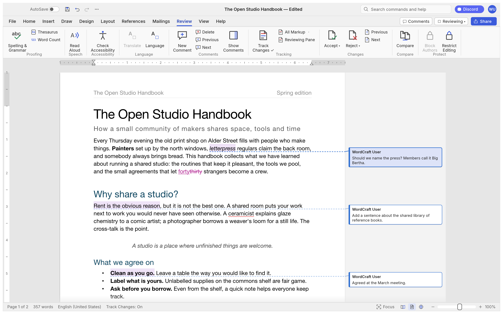
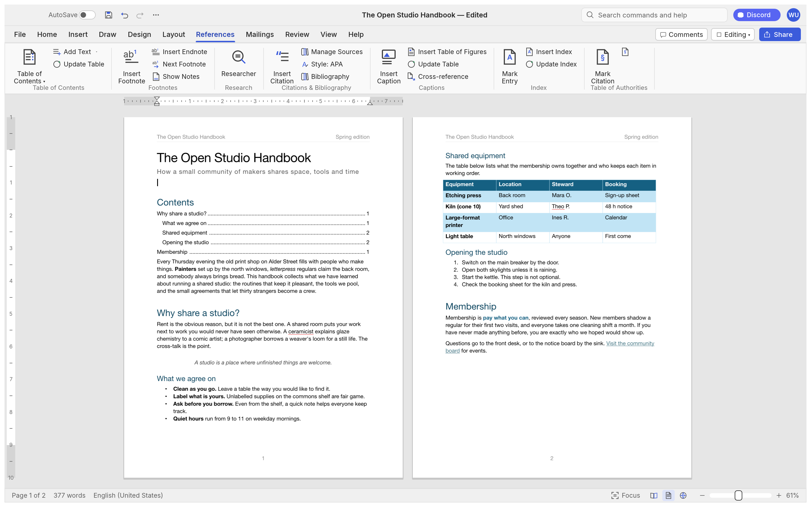
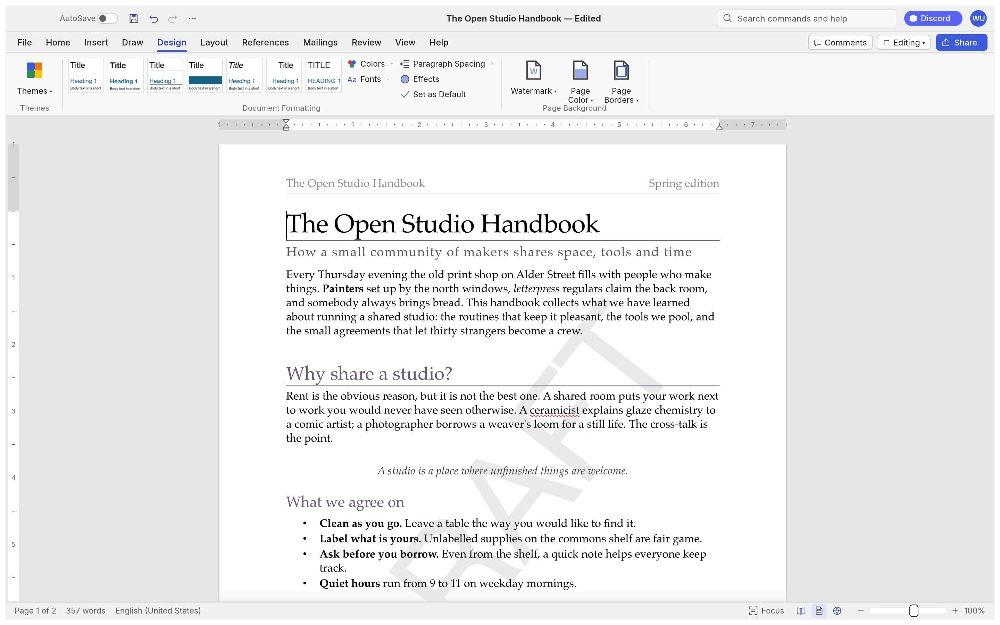
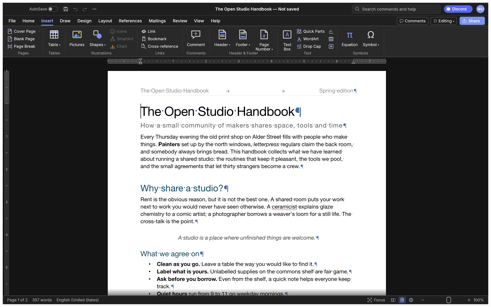
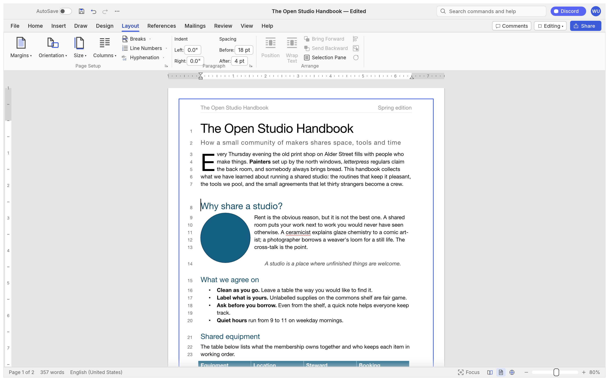
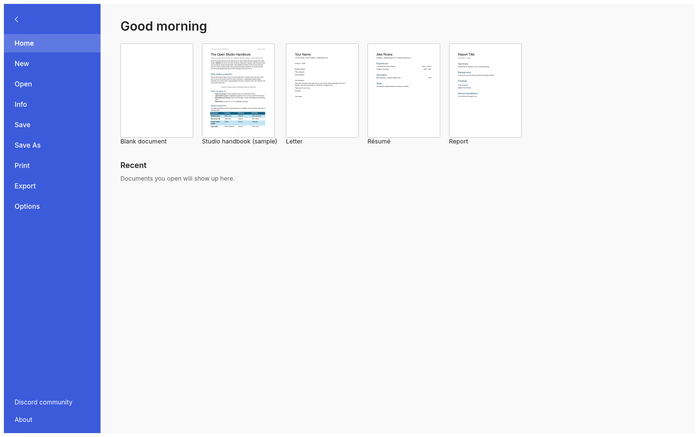

<h1 align="center">WordCraft · DOCX + PDF</h1>

<p align="center">
  <b>A word processor that shows your document as a Word document and as a PDF at the same time,
  side by side, page for page, in pure Rust.</b>
</p>

<p align="center">
  Based on <a href="https://github.com/storytold/wordcraft">WordCraft</a> by the ArtCraft team
  (MIT OR Apache-2.0), modified: a PDF view beside the page, and PDFs that open as editable
  documents. This is not an official WordCraft or ArtCraft build.
</p>

## DOCX, PDF, DOCX + PDF

The switch in the middle of the title bar picks how you see the document:

- **DOCX**: the document, as WordCraft has always shown it.
- **PDF**: the document as a PDF, filling the window.
- **DOCX + PDF**: both at once. The document on the left, its PDF on the right, on the same page:
  scroll the document and the PDF follows; scroll the PDF (with the pointer over it) and the
  document follows. Drag the edge between them to resize.

The PDF is the real thing: what File › Export › PDF would write. While you type it is made again a
moment after each pause (on a background thread, so typing never waits), and the page images stay
on screen until their new versions arrive.

**Opening a PDF** (File › Open, drag and drop, the command line) converts it into an editable
document, page for page: every PDF page becomes a section of the same size, so page 7 of the
document is page 7 of the PDF. Text becomes paragraphs at their places with their fonts, sizes,
colours and weights, set as wide as in the PDF; lines with wide gaps (table rows, two columns) get
tab stops; footers and text beside other text are pinned in text boxes; pictures and vector
drawing (rules, table fills, panels) are anchored behind the text. Until you edit it, the PDF
view shows the PDF you opened; Save asks where to save the document (as .docx, named after the
PDF) and never writes over the PDF.

## Editing the PDF

In **PDF** mode (and in the PDF half of **DOCX + PDF**) the PDF itself can be edited, and saved
back over the PDF it came from (**Save PDF**, Ctrl+S) or anywhere else (**Save As**). Opening a
PDF goes straight to PDF mode. Everything below works on any PDF and on the document's own export:

- **Mark up:** Highlight, Underline and Strikethrough snap to the words you drag over; Pen
  (freehand), Line, Arrow, Rectangle, Oval; Notes; Stamps (Approved, Draft, Confidential… or your
  own words); Pictures; your Signature, drawn once and placed anywhere. Marks are real PDF
  annotations, each one selectable: move it, resize it by its handles, nudge it with the arrow
  keys, change its colour or thickness, or delete it.
- **Text:** Text Box: drag a box and type; with *Fit text to box* (on by default) the font size
  follows the box as you resize it. **Edit Text**: click a line of the PDF's own text and change
  it; the new text is set in the line's font, size, weight and colour.
- **Cover and remove:** Whiteout covers part of a page; **Redact** blacks it out for good: the page
  is rebuilt as a picture with the area black, so the text, pictures and drawing under it are gone
  from the saved file, not just hidden.
- **Pages** (the Pages panel, a page's right-click menu): rotate, delete, duplicate, move up and
  down, insert a blank page, insert the pages of another PDF (merge), extract pages to a new PDF,
  split a PDF into parts, crop (drag the part to keep), flip and scale (`pdf.transform`).
- **Document:** watermarks; page numbers, headers and footers (`Page {n} of {N}`, six positions);
  properties (title, author, subject, keywords); find, with every match highlighted; select text
  and copy it, or copy all of it; export pages as PNG or JPEG.
- **Forms:** text fields, check boxes, radio buttons and choice lists are filled in on the page.
- **Saving:** with a password (AES-128; a password-protected PDF opens with its password and saves
  with it again), flattened (every page a picture), compressed. Undo and Redo (Ctrl+Z, Ctrl+Y)
  step through every PDF edit.

**PDF edits show in the document too.** A line, arrow, rectangle, oval, ink, signature,
picture, text box, stamp, whiteout or redaction drawn on the PDF appears in the DOCX as a
floating object in front of the text, at the same place on the same page; highlighting,
underlining or striking text on the PDF formats the same words in the DOCX, and Edit Text
changes them there. Move, resize, recolour, retype or delete the mark, or undo it, and the
document follows; each such change is one undo step in the document, and the twins are saved
with the .docx. (Notes stay in the PDF; marks made after pages were turned, moved, deleted,
inserted or cropped stay in the PDF, since its pages no longer match the document's.)

Edits are kept as a list and applied over the PDF as it is shown, so each one stays editable until
you save. They are the `pdf.*` commands (`wordcraft-cli commands`, MCP), so scripts and agents can
do all of this too; the editing lives in [`crates/pdfedit`](crates/pdfedit) (using
[lopdf](https://github.com/J-F-Liu/lopdf), MIT) and the tools in
[`crates/ui-egui/src/pdf_edit.rs`](crates/ui-egui/src/pdf_edit.rs).

Not done: text recognition (OCR) of scanned pages, certificate-based digital signatures (the
Signature tool places a drawn signature, it doesn't sign cryptographically), deskew and
perspective correction of scans, and text added in boxes and edits is drawn as shapes rather than
as searchable text.

## From PDF to document

Not rebuilt from a PDF: real Word tables and columns, gradients, clipping, rotated or vertical
text, and the text of scanned pages (they come in as pictures). The converter and the PDF view
live in [`crates/pdfread`](crates/pdfread) and use [hayro](https://github.com/LaurenzV/hayro)
(MIT OR Apache-2.0), a pure-Rust PDF reader and rasteriser; the PDF view is
[`crates/ui-egui/src/pdf_view.rs`](crates/ui-egui/src/pdf_view.rs). Scripts and agents switch
modes with the `ui.pdfView` command (`{"mode": "docx" | "pdf" | "side"}`).

<br>

<p align="center">
  <a href="#a-tour">A tour</a> ·
  <a href="#why-wordcraft">Why WordCraft</a> ·
  <a href="#what-works-today">What works today</a> ·
  <a href="#quick-start">Quick start</a> ·
  <a href="#for-agents-cli-and-mcp">For agents</a> ·
  <a href="#architecture">Architecture</a> ·
  <a href="#roadmap">Roadmap</a> ·
  <a href="#downloads">Downloads</a> ·
  <a href="#license-and-credits">License and credits</a>
</p>

## A tour

Every screenshot below is WordCraft itself, rendered offscreen by its own UI test harness
(`cargo run -p wordcraft-ui-egui --example ui_shot`).

<table>
<tr>
<td width="50%" valign="top"><p align="center"><sub><b>Review.</b> Track changes, comment balloons in the margin, accept and reject, spelling and grammar as you type.</sub></p></td>
<td width="50%" valign="top"><p align="center"><sub><b>References.</b> Tables of contents, footnotes, citations in APA, MLA, Chicago or IEEE, index and captions.</sub></p></td>
</tr>
<tr>
<td width="50%" valign="top"><p align="center"><sub><b>Design.</b> Themes, style sets, paragraph spacing, watermarks, page colour and borders.</sub></p></td>
<td width="50%" valign="top"><p align="center"><sub><b>Dark mode</b> with formatting marks, and the Insert tab: tables, pictures, shapes, links, headers, footers, fields and symbols.</sub></p></td>
</tr>
<tr>
<td colspan="2"><p align="center"><sub><b>Layout.</b> Drop caps, text wrapping around pictures and shapes, automatic hyphenation, line numbers and page borders.</sub></p></td>
</tr>
<tr>
<td colspan="2"><p align="center"><sub><b>File.</b> Start from a template, open recent documents, edit properties, export to PDF and other formats.</sub></p></td>
</tr>
</table>

## Why WordCraft

- **Familiar.** Ribbon tabs, groups, shortcuts and behaviour: Enter continues a list,
  Tab demotes it, Ctrl/⌘+B bolds the word under the caret, the Styles gallery previews styles live,
  F4 repeats, F7 checks spelling, F8 extends the selection.
- **Your files.** Opens and saves .docx (OOXML), and also .odt, .rtf, .html, .md, .tex (LaTeX), .txt; opens legacy 97-2003 .doc; exports PDF
  with real, selectable text, links and bookmarks.
- **Fast.** Paragraph layout is cached, so typing in a 188-page document re-lays it out in about
  1.4 ms; pages render on demand.
- **Everywhere.** One Rust codebase for macOS, Windows, Linux, BSD and the web. No Electron, no
  Tauri: native [egui](https://github.com/emilk/egui) on the GPU.
- **Built for agents.** Every action is a command with an id. The same 422 commands drive the
  ribbon, keyboard shortcuts, the command search, a command-line tool, a JSON control channel and
  an MCP server.
- **Private.** Spelling, grammar and everything else work offline.
- **Open.** MIT OR Apache-2.0. Clean-room: built from public specifications and observation, with
  every asset original or openly licensed.

## What works today

| Area | Highlights |
|---|---|
| **Writing** | Fast typing with IME, smart quotes, AutoCorrect, list autoformat (`* `, `1. `), dashes; word, sentence, paragraph selection; drag-select; clipboard with formatting; undo/redo; find and replace with regex |
| **Formatting** | Fonts, sizes, bold/italic/underline styles, strike, sub/superscript, caps, highlight, colours, character spacing, Format Painter, Change Case, Clear Formatting |
| **Paragraphs** | Alignment, indents (draggable on the ruler), spacing, line spacing, tabs with leaders, borders, shading, keep with next, widow/orphan control |
| **Styles** | Built-in style set, live gallery, Styles pane, create/modify/update styles, style sets, themes |
| **Lists** | Bullets, numbering, multilevel, restart, set value, custom formats |
| **Tables** | Insert by grid, merge/split, styles with banded rows, borders, shading, header rows repeated across pages, rows that split across pages, sort, formulas, text ↔ table |
| **Pages** | Margins, orientation, size, columns, page/column/section breaks, headers and footers (first page, odd/even), page numbers, watermark, page borders, line numbers, vertical alignment, drop caps, automatic hyphenation |
| **Objects** | Pictures (resize, crop, recolour, brightness/contrast, transparency, background removal, picture styles, rotate), shapes, text boxes, floating position with text wrapping (square, top and bottom, behind or in front of text) |
| **References** | Table of contents, footnotes and endnotes, citations and bibliography (APA, MLA, Chicago, IEEE), captions, table of figures, cross-references, index, table of authorities |
| **Review** | Spelling and grammar with suggestions (English and Polish, by each run's language), thesaurus, word count, comments in margin balloons or a pane, track changes, accept/reject, compare documents, restrict editing, accessibility checker, document inspector |
| **Mailings** | Mail merge from CSV, merge fields, address block, greeting line, rules, preview, finish to a document; envelopes and labels |
| **View** | Print layout, web layout, draft, read mode, focus, zoom, one/multiple pages, page width, Navigation pane, rulers, gridlines, dark mode; interface in English, 简体中文, 繁體中文, 日本語, Português (Brasil), Español, Українська, Српски / Srpski, Eesti, Türkçe, Русский, Italiano, Deutsch, Polski, Čeština, Magyar, Français, Български, Tiếng Việt, 한국어 or Svenska (follows the system language by default) |
| **Files** | .docx read/write, legacy 97-2003 .doc import, PDF export, .odt, .rtf, .html, .md, .tex, .txt import/export, page images |

The honest picture, area by area, is in [ROADMAP.md](ROADMAP.md), the
[parity assessment](docs/target-app-parity.md) and the generated
[feature checklist](docs/parity-checklist.md).

## Quick start

```sh
git clone https://github.com/storytold/wordcraft
cd wordcraft
cargo run --release -p wordcraft -- --sample        # the desktop app with the sample document
cargo run --release -p wordcraft -- report.docx     # open a document
```

Command line:

```sh
wordcraft-cli convert report.docx report.pdf        # docx, pdf, odt, rtf, html, md, tex, txt, png
wordcraft-cli text report.docx                      # plain text
wordcraft-cli inspect report.docx                   # structure as JSON
wordcraft-cli run --template sample \
  --cmd 'select.text={"text":"Membership"}' --cmd format.bold --save out.docx
wordcraft-cli run --script job.json                 # the same from a file: commands, then save to docx and pdf
```

Web: `cd apps/wordcraft-web && trunk serve`, then open <http://127.0.0.1:8771/?sample>.

## For agents: CLI and MCP

WordCraft was designed to be driven by people *and* by AI agents.

```sh
claude mcp add wordcraft -- wordcraft-cli mcp                  # headless documents
# confine the agent to folders: wordcraft-cli mcp --automation-read-root DIR --automation-write-root DIR
wordcraft --control 7981 &                                     # or drive the running app…
claude mcp add wordcraft-app -- wordcraft-cli mcp --connect 127.0.0.1:7981
```

Tools include `list_commands`, `execute`, `batch`, `type_text`, `select_text`, `inspect_document`,
`render_page`, `save_document`, and, with a running app, `screenshot`, `click` and `key`. Agents
can check their work through `inspect_document` without screenshots. See [docs/mcp.md](docs/mcp.md)
and the [control protocol](docs/control-protocol.md). Macros record any sequence of commands and
play it back (`tools.recordMacro`, `tools.macros`).

## Logs

The desktop app writes its log records to standard error and to `logs/wordcraft.log` next to its
preferences: on Linux `$XDG_CONFIG_HOME/wordcraft/logs/` (by default `~/.config/wordcraft/logs/`),
on macOS `~/Library/Application Support/WordCraft/logs/`, on Windows `%APPDATA%\WordCraft\logs\`.
A start from a desktop menu or the Dock has no terminal, so this file is what to attach to a bug
report: unreadable parts of a .docx, pictures or fonts a PDF export had to leave out and panics the
command guard recovered from land there. Each launch moves the previous log to `wordcraft.1.log`
(and that one to `wordcraft.2.log`), so the log of a run that crashed survives the next start; a
log stops growing at 16 MiB. `--version` writes no file, and runs with `WORDCRAFT_NO_PREFS` (agents'
test runs) log to standard error only. Document text is never logged; a panic message leaves out
the text it quotes.

By default WordCraft's own crates log at `info` and everything else at `warn`. `RUST_LOG` replaces
that with env_logger-style directives, for example `RUST_LOG=debug`,
`RUST_LOG=warn,wordcraft_docx=trace` or `RUST_LOG=info,wgpu_core=warn`; a directive ending in `*`
covers every target starting with it (`wordcraft*=debug`). The logger is
`apps/wordcraft/src/logging.rs`.

## Architecture

| Layer | Crate | Job |
|---|---|---|
| L0 | `wordcraft-geom` | units and measurements |
| L1 | `wordcraft-doc`, `wordcraft-fonts`, `wordcraft-proof` | document model and editing; fonts and shaping; spelling, grammar, hyphenation |
| L2 | `wordcraft-layout`, `wordcraft-docx`, `wordcraft-formats` | line breaking, pagination, tables, notes, hit testing; OOXML; ODT/RTF/HTML/Markdown/TXT |
| L3 | `wordcraft-render`, `wordcraft-pdf` | rasteriser (vello_cpu); PDF ([craft-pdf](docs/shared-pdf.md), Krilla) |
| L4 | `wordcraft-engine` | session, undo, 422 commands, document feature catalog |
| L5 | `wordcraft-mcp` | MCP server |
| L6 | `wordcraft-ui-egui` | the word processor front end (swappable) |
| apps | `wordcraft`, `wordcraft-cli`, `wordcraft-web` | desktop, command line, browser |

`cargo xtask ci` runs formatting, clippy, ~800 tests, the asset-attribution check, the layering
check and the wasm build. Contributor and agent instructions: [AGENTS.md](AGENTS.md).

## Roadmap

WordCraft is in **alpha**. It has commands for 97% of the ribbon and menu features in its feature catalog
([`docs/parity-checklist.md`](docs/parity-checklist.md)) today; counting
depth, file fidelity, stability and the rest, we estimate it is about 60% ready for real work,
about 55% for a typical professional's weekly work and about 63% for everyday essentials. Beta
needs testing against real-world .docx files, keeping charts and SmartArt through a round trip,
closer pagination fidelity, a stability sweep and native printing. Details and estimates:
[ROADMAP.md](ROADMAP.md) and [where we fall short](docs/gaps.md).

## Downloads

**Download WordCraft** from GitHub: the [latest release](https://github.com/storytold/wordcraft/releases/latest) has every build listed below, and [all releases](https://github.com/storytold/wordcraft/releases) has earlier versions and their notes. `<ver>` in the file names is the version number, and `SHA256SUMS.txt` lists a checksum for every file.

### Windows

| Build | Installer | Portable |
|---|---|---|
| x64 (64-bit Intel/AMD) | `wordcraft-<ver>-windows-x64.msi` | `wordcraft-<ver>-windows-x64-portable.zip` |
| arm64 (Snapdragon and other ARM PCs) | `wordcraft-<ver>-windows-arm64.msi` | `wordcraft-<ver>-windows-arm64-portable.zip` |
| x86 (32-bit) | `wordcraft-<ver>-windows-x86.msi` | `wordcraft-<ver>-windows-x86-portable.zip` |

Installers and executables are code-signed.

**If the app doesn't open on Windows:** the desktop app initializes only DirectX 12 by default.
Letting wgpu also create an OpenGL instance can crash some graphics drivers (AMD's
`atio6axx.dll`) before the window appears, so the app would flash in Task Manager and quit.
`WGPU_BACKEND` overrides the default for troubleshooting (for example `dx12` or `vulkan`). In
PowerShell, from the folder containing the executable:

```powershell
$env:WGPU_BACKEND = "vulkan"
& .\wordcraft.exe
Remove-Item Env:WGPU_BACKEND                     # restore the default for later launches
```

An explicit `gl` override can bring the driver crash back on affected systems. The macOS, Linux
and web backend defaults are unchanged.

The **32-bit** build uses OpenGL even when a DirectX 12 graphics card is present. On 32-bit
Windows, creating a DirectX 12 graphics pipeline fails immediately and the app exits before the
window appears. `WGPU_BACKEND=vulkan` (or `dx12`) still overrides that.

**If the app quits right after its window appears with "Parent device is lost" in the log:**
WordCraft compiles DirectX 12 shaders with FXC, the compiler built into Windows, so it needs no
`dxcompiler.dll`/`dxil.dll` and ignores any copy another program put on `PATH` (#603).
`WGPU_DX12_COMPILER` (`fxc`, `dxc`, `auto`) overrides this; with `dxc`, a matching
`dxcompiler.dll` *and* `dxil.dll` must sit next to `wordcraft.exe`. `WGPU_BACKEND = "vulkan"`
also avoids DirectX 12 altogether.

**If the app is slow on an older Windows PC:** when DirectX 12 finds no graphics card with a
driver for it (for example Intel 4th-generation graphics on Windows 11), it only offers the built-in
software renderer, which draws every frame on the processor. WordCraft normally uses OpenGL instead,
without setting anything. If OpenGL has no usable adapter, it can use DirectX 12's WARP software
adapter. The log file records the choice (lines starting with
`graphics:`). `WGPU_BACKEND` still overrides it, e.g. `$env:WGPU_BACKEND = "gl"` or `"dx12"`.

### macOS

| Build | File | Notes |
|---|---|---|
| App, universal (Apple silicon + Intel) | `wordcraft-<ver>-macos-universal.dmg` | Signed and notarized |
| Command-line tool, universal | `wordcraft-cli-<ver>-macos-universal.zip` | Signed and notarized |

### Linux

| Format | x86_64 | aarch64 (ARM64) | Notes |
|---|---|---|---|
| AppImage | `wordcraft-<ver>-linux-x86_64.AppImage` | `wordcraft-<ver>-linux-aarch64.AppImage` | Runs anywhere; updates itself with [AppImageUpdate](https://github.com/AppImageCommunity/AppImageUpdate) (`.zsync` files) |
| Flatpak | `wordcraft-<ver>-linux-x86_64.flatpak` | `wordcraft-<ver>-linux-aarch64.flatpak` | Sandboxed; `flatpak install --user <file>` |
| Debian/Ubuntu | `wordcraft-<ver>-linux-x86_64.deb` | `wordcraft-<ver>-linux-aarch64.deb` | |
| Fedora/RHEL/openSUSE | `wordcraft-<ver>-linux-x86_64.rpm` | `wordcraft-<ver>-linux-aarch64.rpm` | |
| Tarball | `wordcraft-<ver>-linux-x86_64.tar.gz` | `wordcraft-<ver>-linux-aarch64.tar.gz` | Unpack anywhere |

RISC-V (riscv64): `wordcraft-<ver>-linux-riscv64.tar.gz`, a tarball cross-compiled for glibc 2.39+
(Ubuntu 24.04, Debian 13 and newer).

**Wayland:** on a Wayland desktop the app runs through XWayland when it is available, because
winit (the windowing library) supports dragging files into the window only on X11. To use the
native Wayland backend instead (for example for sharper text with fractional scaling, at the cost
of file drag-and-drop), start it with `WORDCRAFT_WAYLAND=1`:

```sh
WORDCRAFT_WAYLAND=1 wordcraft
```

**Arch Linux (AUR).** Community members maintain three AUR packages; the project doesn't publish
to the AUR itself. Install one of them:
| Package | What it installs | Choose it when |
|---|---|---|
| [`wordcraft-bin`](https://aur.archlinux.org/packages/wordcraft-bin) | The release tarball above, prebuilt (x86_64, aarch64) | You want the latest release without compiling (quickest) |
| [`wordcraft`](https://aur.archlinux.org/packages/wordcraft) | The latest release, built from source with `cargo` | You prefer to build releases yourself |
| [`wordcraft-git`](https://aur.archlinux.org/packages/wordcraft-git) | The current `main` branch, built from source | You want unreleased changes and accept an occasional broken build |
For example `yay -S wordcraft-bin` or `paru -S wordcraft-bin`.

#### Community packages

These packages are maintained by community members, not by the WordCraft team.

On Gentoo, the [::snakebyte overlay](https://github.com/switch87/snakebyte-overlay) packages the
Linux release as `app-office/wordcraft-bin` (prebuilt) and `app-office/wordcraft` (built from source):

```sh
eselect repository add snakebyte git https://github.com/switch87/snakebyte-overlay.git
emaint sync -r snakebyte
echo 'app-office/wordcraft-bin ~amd64' >> /etc/portage/package.accept_keywords/wordcraft
emerge --ask app-office/wordcraft-bin
```

### FreeBSD

| Build | File |
|---|---|
| x86_64 | `wordcraft-<ver>-freebsd-x86_64.tar.gz` |

### Web (WebAssembly)

| Build | File | Notes |
|---|---|---|
| Static site | `wordcraft-web-<ver>.zip` | Runs in a modern browser; host it on any static server |

## License and credits

WordCraft is dual-licensed under [MIT](LICENSE-MIT) or [Apache-2.0](LICENSE-APACHE), at your option.
Copyright (c) 2026 ArtCraft Team and the WordCraft contributors. Required notices are in [NOTICE](NOTICE).

Bundled fonts, icons, images and other assets keep their own open licenses; each one is listed
with its author, source and license in [ATTRIBUTION.md](ATTRIBUTION.md).

The English spelling dictionary and hyphenation come from Grady Ward's public-domain Moby
Hyphenator II word list. Polish spelling reads the Hunspell `pl_PL` dictionary installed on the system (not bundled), as
do Russian, Portuguese, Czech, Italian, Croatian and Turkish spelling (how to install them:
[docs/spelling-dictionaries.md](docs/spelling-dictionaries.md)), and
Polish hyphenation the TeX patterns by Hanna Kołodziejska, Bogusław Jackowski and Marek Ryćko (MIT
option). The sample documents and templates are original text written for WordCraft.

This is a modified version of WordCraft. Following upstream WordCraft's brand licence ("Forks and
modified versions"), the ArtCraft name, wordmark and logos have been removed from it; it is based
on WordCraft by the ArtCraft team and is not an ArtCraft product.

The PDF view and PDF opening use [hayro](https://github.com/LaurenzV/hayro) by Laurenz Stampfl
(MIT OR Apache-2.0); PDF editing uses [lopdf](https://github.com/J-F-Liu/lopdf) (MIT).
